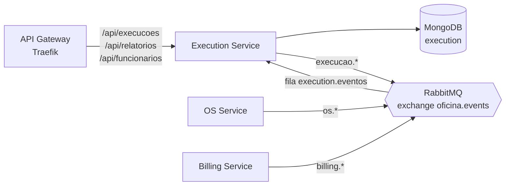
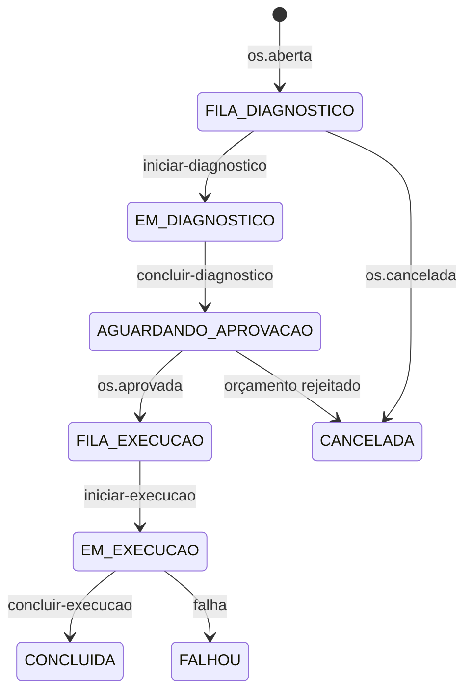

# Oficina — Execution Service

Microsserviço de **execução e produção** da oficina (Tech Challenge SOAT, Fase 4).
Foi extraído do monólito
[`fiat-tech-challenge-ddd`](https://github.com/gilgledson/fiat-tech-challenge-ddd).

Responsabilidades:

- Gerenciar a fila de diagnóstico e a fila de execução das ordens de serviço.
- Registrar o andamento do diagnóstico e de cada serviço (quem fez, início e fim).
- Comunicar ao OS Service o início e a conclusão de cada etapa.
- Reportar falhas de execução, disparando a compensação da Saga.
- Relatórios de esforço por OS e de tempo médio por serviço.
- Cadastro de funcionários.

O que **não** é daqui: itens, preços, estoque e o status oficial da OS
continuam no OS Service; orçamento e pagamento ficam no Billing Service.

## Tecnologias

| Item | Escolha |
|---|---|
| Linguagem / framework | Java 17, Quarkus 3.15 |
| Banco de dados | MongoDB próprio (database `execution`) |
| Mensageria | RabbitMQ (SmallRye Reactive Messaging) |
| Autenticação | JWT RS256 emitido pelo OS Service; aqui só é validado |
| Observabilidade | New Relic (Java Agent), logs JSON com `correlationId` |
| Testes e qualidade | JUnit 5, Mockito, JaCoCo (mínimo de 80%), SonarCloud |

### Por que MongoDB

O andamento de uma OS é lido e gravado sempre inteiro: fase atual, serviços,
tempos e histórico de fases. Isso é um documento por OS, sem junções. O
histórico cresce como lista dentro do documento e os relatórios saem dos
tempos gravados ali, sem as views que o monólito mantinha sobre as tabelas da OS.

## Arquitetura



Organização do código, por contexto (`execucao`, `funcionario`):

- `domain` — agregado `OrdemExecucao` e regras de transição de fase.
- `application` — casos de uso, portas e listener de eventos.
- `infrastructure` — documentos MongoDB, outbox e RabbitMQ.
- `api` — endpoints REST.

O Execution Service não faz chamadas síncronas a outros serviços e não
acessa o banco de ninguém.

### Fases de uma OS



`FALHOU` e `CANCELADA` podem ser alcançadas a partir de qualquer fase ativa.

## Saga Pattern: coreografia

O fluxo da OS é uma **Saga coreografada**: não há orquestrador central; cada
serviço reage aos eventos dos outros e publica os seus. A justificativa da
escolha está no README do
[Billing Service](https://github.com/gilgledson/oficina-billing-service#saga-pattern-coreografia).

### Eventos consumidos

Fila `execution.eventos`, ligada à exchange `oficina.events` (tipo `topic`).

| Routing key | Payload | O que o Execution faz |
|---|---|---|
| `os.aberta` | `ordemServicoId` | Coloca a OS na fila de diagnóstico |
| `os.aprovada` | `ordemServicoId`, `servicos[]` (`id`, `servicoId`, `nome`) | Coloca a OS na fila de execução com os serviços aceitos |
| `os.cancelada` | `ordemServicoId`, `motivo` (opcional) | **Compensação:** tira a OS da fila |
| `os.rejeitada`, `billing.orcamento-rejeitado` | `ordemServicoId` | **Compensação:** tira a OS da fila |
| `billing.orcamento-falhou` | `ordemServicoId` | **Compensação:** tira a OS da fila |

### Eventos publicados

Todos levam `ordemServicoId`.

| Routing key | Campos extras | Quando |
|---|---|---|
| `execucao.diagnostico-iniciado` | — | Mecânico tirou a OS da fila de diagnóstico |
| `execucao.diagnostico-concluido` | — | Diagnóstico pronto; a OS segue para orçamento |
| `execucao.iniciada` | — | Execução da OS aprovada começou |
| `execucao.servico-iniciado` | `servicoOsId`, `usuarioExecutorId`, `em` | Um serviço começou a ser executado |
| `execucao.servico-finalizado` | `servicoOsId`, `em` | Um serviço foi finalizado |
| `execucao.concluida` | — | Todos os serviços finalizados; a OS segue para pagamento |
| `execucao.falhou` | `motivo` | **Compensação:** a oficina não consegue concluir a OS |

### Consistência

- **Outbox dentro do documento:** os eventos gerados por uma operação são
  gravados na lista `outbox` do próprio documento da execução. Como o MongoDB
  grava um documento de forma atômica, estado e eventos nunca divergem, sem
  precisar de transação multi-documento. O `OutboxRelay` entrega os pendentes
  ao RabbitMQ a cada 2 segundos e só os remove depois da confirmação do broker.
- **Concorrência otimista:** cada documento tem um campo `versao`. Duas
  operações simultâneas na mesma OS não se sobrescrevem: a segunda recebe 409.
- **Consumo idempotente:** a entrega é "pelo menos uma vez". Abertura,
  aprovação e cancelamento repetidos são ignorados.
- **Fila de mensagens mortas:** mensagem que falha no processamento vai para
  `execution.eventos.dlq`.

## API

Todas as rotas exigem JWT. Swagger: `/q/swagger-ui`. Healthchecks: `/q/health`.

| Método | Rota | Perfis | Descrição |
|---|---|---|---|
| `GET` | `/api/execucoes/fila?tipo=DIAGNOSTICO\|EXECUCAO` | ADMIN, MECANICO, ATENDENTE | Fila, na ordem de atendimento |
| `GET` | `/api/execucoes/{osId}` | ADMIN, MECANICO, ATENDENTE | Andamento e histórico da OS |
| `POST` | `/api/execucoes/{osId}/iniciar-diagnostico` | ADMIN, MECANICO | Inicia o diagnóstico |
| `POST` | `/api/execucoes/{osId}/concluir-diagnostico` | ADMIN, MECANICO | Conclui o diagnóstico |
| `POST` | `/api/execucoes/{osId}/iniciar-execucao` | ADMIN, MECANICO | Inicia a execução |
| `POST` | `/api/execucoes/{osId}/servicos/{servicoOsId}/iniciar` | ADMIN, MECANICO | Inicia um serviço |
| `POST` | `/api/execucoes/{osId}/servicos/{servicoOsId}/finalizar` | ADMIN, MECANICO | Finaliza um serviço |
| `POST` | `/api/execucoes/{osId}/concluir-execucao` | ADMIN, MECANICO | Conclui a execução |
| `POST` | `/api/execucoes/{osId}/falha` | ADMIN, MECANICO | Reporta falha (`{"motivo": "..."}`) |
| `GET` | `/api/relatorios/esforco-os/{osId}` | ADMIN, MECANICO | Serviços realizados e minutos gastos |
| `GET` | `/api/relatorios/tempo-medio-servicos` | ADMIN | Tempo médio histórico por serviço |
| — | `/api/funcionarios` | ADMIN | Cadastro de funcionários (mesmas rotas do monólito) |

Operação inválida para a fase atual responde `409`; OS desconhecida, `404`.

## Como executar

Requer JDK 17 e Docker.

```bash
./mvnw clean package -DskipTests
```

```bash
docker compose up --build
```

A API sobe em `http://localhost:8385`, o MongoDB na porta `27018` e o painel
do RabbitMQ em `http://localhost:15672` (`oficina`/`oficina`).

Testes e cobertura (falha abaixo de 80% de linhas; relatório em
`target/site/jacoco/index.html`):

```bash
./mvnw clean verify
```

### Variáveis de ambiente

| Variável | Descrição | Padrão |
|---|---|---|
| `MONGODB_URL` | Connection string do MongoDB | `mongodb://localhost:27017` |
| `MONGODB_DATABASE` | Nome do database | `execution` |
| `RABBITMQ_HOST`, `RABBITMQ_PORT` | Broker | `localhost`, `5672` |
| `RABBITMQ_USERNAME`, `RABBITMQ_PASSWORD` | Credenciais do broker | `guest` |

## CI/CD

O pipeline em [`.github/workflows/ci.yml`](.github/workflows/ci.yml) tem dois jobs:

1. **Build, testes e qualidade** — em todo PR e push na `main`: compila, roda
   os testes e exige 80% de cobertura. Se o secret `SONAR_TOKEN` estiver
   configurado, envia também a análise ao SonarCloud.
2. **Deploy** — só em push na `main`: publica a imagem no Docker Hub e aplica
   os manifestos de [`k8s/`](k8s) no AKS.

Configuração necessária no repositório:

- Secrets: `SONAR_TOKEN` (opcional), `DOCKERHUB_USERNAME`, `DOCKERHUB_TOKEN`,
  `AZURE_CREDENTIALS`, `EXECUTION_MONGODB_URL`, `RABBITMQ_USERNAME`,
  `RABBITMQ_PASSWORD`, `NEW_RELIC_LICENSE_KEY`.
- Variables: `SONAR_ORGANIZATION`, `SONAR_PROJECT_KEY`.

## Pendências

- Provisionar o MongoDB em produção (ex.: Azure Cosmos DB for MongoDB) e o
  RabbitMQ no cluster.
- Cenário **BDD** do fluxo completo da OS.
- Evidência de cobertura e link do SonarCloud, depois da primeira execução do
  pipeline.
- O serviço ainda não foi executado contra MongoDB e RabbitMQ reais; a
  validação até aqui é de compilação e testes unitários.
- Dados existentes de funcionários e de tempos de execução do monólito não
  foram migrados.
